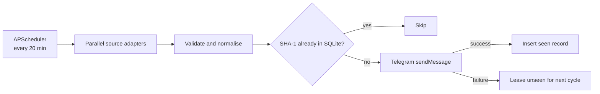

# Hackathon Radar

Hackathon Radar is a personal Python worker that polls major hackathon platforms every 20 minutes, sends new listings to one Telegram DM, and archives successful notifications in SQLite.

## Why it exists

Hackathons are announced across unrelated platforms with different data formats. Manual checking is slow and easy to forget. This worker gives one person a single, near-real-time Telegram feed with the title, dates, prize, mode, tags, team size, eligibility, description, and application link when those fields are available.

## Current coverage

| Source | Live contract used | Notes |
|---|---|---|
| Devpost | `devpost.com/api/hackathons` | Polls the newest open listings; the former RSS/page endpoints are Cloudflare-blocked from this host. |
| Devfolio | Embedded `__NEXT_DATA__` on `/hackathons` | Reads open hackathons and registration deadlines. |
| DoraHacks | `/api/v1/hub/hackathons` | Reads upcoming and ongoing pages with polite delays. |
| MLH | Embedded JSON on season pages | Reads the current and next season by default. |
| Lablab.ai | `starfieldlabs.ai/events` | Lablab now redirects to Starfield Labs; zero events is a valid result. |
| HackerEarth | `/api/community/challenges/compete/` | Filters the current listing to `type == Hackathon` and unexpired entries. |
| Gitcoin | `gitcoin.co/campaigns` | Emits only campaign cards explicitly labelled hackathon, buildathon, or bounty. The old Grants Stack API host is gone. |
| X | `/2/tweets/search/recent` | Optional. Requires an X developer bearer token and account access to recent search. |

Source contracts were live-checked on 2026-11-16. They are public or undocumented surfaces and can change. Run `make smoke-sources` after deployment or whenever a provider stops producing results.

## Architecture



One source failure is isolated from the rest of the cycle. The scheduler allows only one cycle at a time. Every outside call has a bounded timeout.

## Quick start

Requirements: Python 3.11 or newer.

```bash
git clone https://github.com/arinze116/my-bot.git
cd my-bot
python3 -m venv .venv
.venv/bin/pip install -r requirements.txt
cp .env.example .env
```

Edit `.env`, then export it into the current shell (the application does not auto-load dotenv files):

```bash
set -a
. ./.env
set +a
```

Alternatively, export only the required values or set them in your host:

```bash
export TELEGRAM_BOT_TOKEN="replace-me"
export TELEGRAM_CHAT_ID="replace-me"
```

Never commit the real values. `.env` is ignored.

Run a no-write source and formatting check:

```bash
.venv/bin/python main.py --run-once --dry-run
```

Start the scheduled worker:

```bash
.venv/bin/python main.py
```

On the first successful read of each source, the default `BOOTSTRAP_MODE=baseline` archives current listings without sending them. This prevents a new deployment from flooding Telegram. To deliberately send all currently returned listings once:

```bash
.venv/bin/python main.py --run-once --notify-existing
```

## Telegram setup

1. Open `@BotFather` in Telegram and run `/newbot`.
2. Store the returned token as `TELEGRAM_BOT_TOKEN`.
3. Send the new bot one message.
4. Open `https://api.telegram.org/bot<TOKEN>/getUpdates` locally and copy your private chat's `message.chat.id`.
5. Store that value as `TELEGRAM_CHAT_ID`.

The worker sends one startup status message per process boot. New hackathons are sent individually. Retryable Telegram failures receive at most three attempts with a five-second delay.

## Configuration

| Variable | Default | Purpose |
|---|---|---|
| `TELEGRAM_BOT_TOKEN` | — | Required for real delivery. |
| `TELEGRAM_CHAT_ID` | — | Required private destination chat. |
| `TWITTER_BEARER_TOKEN` | empty | Enables X recent search when present. |
| `TWITTER_QUERIES` | three built-in queries | Separate custom queries with `||`. |
| `DATABASE_PATH` | `seen_hackathons.db` | SQLite path. Use a persistent mounted path in cloud hosting. |
| `POLL_INTERVAL_MINUTES` | `20` | Scheduler interval. |
| `BOOTSTRAP_MODE` | `baseline` | `baseline` archives current items; `notify` sends them. |
| `DEBUG_MODE` | `false` | Sends source errors to Telegram when true. |
| `HTTP_TIMEOUT_SECONDS` | `15` | Per-phase outside-call timeout. |
| `TELEGRAM_RETRY_ATTEMPTS` | `3` | Maximum Telegram attempts. |
| `TELEGRAM_RETRY_DELAY_SECONDS` | `5` | Delay between retryable attempts. |
| `ENABLE_<SOURCE>` | `true` | Toggle any source named in `.env.example`. |
| `DEVPOST_MAX_PAGES` | `2` | Number of newest-open pages per poll. |
| `DORAHACKS_MAX_PAGES` | `2` | Pages per upcoming/ongoing status. |
| `MLH_SEASONS` | current,next | Optional comma-separated season years. |

X is omitted from the active source list when its token is empty, even if `ENABLE_TWITTER=true`.

## Data and deduplication

The notification id follows the PRD exactly:

```text
SHA-1(title.lower() + "|" + url.lower())
```

`seen` stores successfully sent or deliberately baselined listings. `source_state` records which sources have completed first sync, including sources that currently return zero items.

SQLite uses WAL mode and a five-second busy timeout. On a cloud host, `DATABASE_PATH` must point into a persistent volume. A normal process restart preserves deduplication only if that volume remains attached.

Telegram does not accept an idempotency key for `sendMessage`. A crash in the narrow interval after Telegram accepts a message and before SQLite commits can produce one duplicate after restart. Writing SQLite first would avoid that duplicate but could permanently miss the notification, so this project follows the PRD's send-then-mark order.

## Commands

```bash
make setup          # create .venv and install runtime/test tools
make ci             # lint and run the deterministic suite
make smoke-sources  # make live read-only requests to enabled providers
make run-once       # perform one real cycle using configured credentials
```

## Deployment on Railway

Railway currently documents a free plan with $1/month usage credit, not unlimited free compute. Measure the deployed worker's usage before assuming it will remain at zero cost.

1. Push the repository only after reviewing the diff and secret scan.
2. Create a Railway project from the repository.
3. Add a persistent volume and mount it at `/data`.
4. Set `DATABASE_PATH=/data/seen_hackathons.db`.
5. Add `TELEGRAM_BOT_TOKEN`, `TELEGRAM_CHAT_ID`, and optional X credentials.
6. Deploy. The included `Procfile` runs `python main.py`.
7. Confirm the startup DM, logs, volume mount, and `make smoke-sources` results.

Do not use Render's free web service as an always-on SQLite worker without separately solving sleep and persistent-disk behaviour.

## Source adapter contract

Every `scrapers/<source>.py` module exports:

```python
def fetch() -> list[dict]: ...
```

Each item must have `title`, absolute `url`, and `platform`. Optional fields are `prize`, `start_date`, `end_date`, `deadline`, `mode`, `tech_tags`, `team_size`, `eligibility`, and `description`. Dates use `YYYY-MM-DD` when the provider supplies a parseable value.

## Contributing

1. Read `SYSTEM.md`, `MODULES.md`, and the relevant ADR before changing delivery, persistence, or a source contract.
2. Add or update a deterministic parser fixture for provider changes.
3. For data, delivery, timeout, secret, or scheduling invariants, prove the test RED with a controlled fault and then GREEN after restoration.
4. Run `make ci` and `make smoke-sources`.
5. Review `git diff` and staged files for credentials before committing.

## Limits

- No tool can guarantee discovery of every hackathon on the internet.
- Scrapers can break when providers change undocumented HTML or JSON.
- X recent-search availability and cost depend on the owner's developer account.
- This v1 has one private Telegram user, no reminders, and no filtering.
- Host-level backup and restore are not implemented; volume-loss recovery remains unverified.

## Documentation

- `SYSTEM.md`: architecture numbers, rules, and known limits.
- `MODULES.md`: module contracts and failure behaviour.
- `docs/research-2026-11-16.md`: verified endpoint and hosting research.
- `docs/adr/0001-python-worker-and-direct-http.md`: language and client decisions.
- `docs/evidence/RED_GREEN.md`: fault-injection evidence.

## License

Copyright © 2026 Mazi. All rights reserved. See `LICENSE`.
