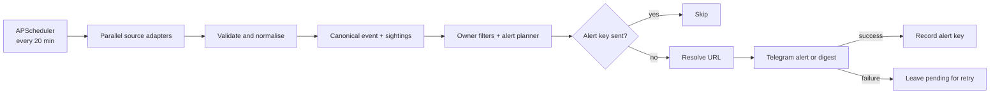

# Hackathon Radar

Hackathon Radar is a private Python intelligence worker that merges hackathon sightings across major platforms and X, then sends owner-filtered New, Deadline, Change, and Ongoing alerts to Telegram.

## Why it exists

Hackathons are announced across unrelated platforms with different data formats. Manual checking is slow and easy to forget. This worker gives one person a single, near-real-time Telegram feed with the title, dates, prize, mode, tags, team size, eligibility, description, and application link when those fields are available.

## Current coverage

| Source | Live contract used | Notes |
|---|---|---|
| Devpost | `devpost.com/api/hackathons` | Polls the newest open listings; the former RSS/page endpoints are Cloudflare-blocked from this host. |
| Devfolio | Embedded `__NEXT_DATA__` on `/hackathons` | Reads open hackathons and registration deadlines. |
| DoraHacks | `/api/v1/hub/hackathons` | Reads upcoming and ongoing pages with polite delays. |
| ETHGlobal | Public `/events` cards | Keeps upcoming/ongoing hackathon cards; the guessed API route is not public. |
| MLH | Embedded JSON on season pages | Reads the current and next season by default. |
| Lablab.ai | `starfieldlabs.ai/events` | Lablab now redirects to Starfield Labs; zero events is a valid result. |
| HackerEarth | `/api/community/challenges/compete/` | Filters the current listing to `type == Hackathon` and unexpired entries. |
| Gitcoin | `gitcoin.co/campaigns` | Emits only campaign cards explicitly labelled hackathon, buildathon, or bounty. The old Grants Stack API host is gone. |
| X | `/2/tweets/search/recent` | Optional. Requires an X developer bearer token and account access to recent search. |

Luma is currently marked **unavailable**, not silently ignored: its public discover page does not
render search results server-side, and the search endpoint used by Luma's official client requires a
signed-in user. See `docs/research-2026-11-17-prd-sources.md`.

The original source contracts were live-checked on 2026-11-16; ETHGlobal and Luma discovery were
checked on 2026-11-17. Public or undocumented surfaces can change. Run `make smoke-sources` after
deployment or whenever a provider stops producing results.

## Architecture



One source failure is isolated from the rest of the cycle. The scheduler allows only one cycle at a time. Every outside call has a bounded timeout.

## Quick start

Requirements: Python 3.11 or newer.

```bash
git clone https://github.com/arinze116/my-bot.git
cd my-bot
python3 -m venv .venv
.venv/bin/pip install -r requirements.txt
cp .env.example .env
```

Edit `.env`. The application loads this project file automatically with `python-dotenv`. When the
file exists, its Telegram token and chat id are authoritative so ambient agent credentials cannot
redirect notifications. Other settings may still be supplied by the process environment.
Alternatively, export the required values directly when no project `.env` exists:

```bash
export TELEGRAM_BOT_TOKEN="replace-me"
export TELEGRAM_CHAT_ID="replace-me"
```

Never commit the real values. `.env` is ignored.

Run a no-write source and formatting check:

```bash
.venv/bin/python main.py --run-once --dry-run
```

Start the scheduled worker:

```bash
.venv/bin/python main.py
```

For this VPS, install the version-controlled systemd unit:

```bash
sudo install -o root -g root -m 0644 deploy/hackathon-radar.service /etc/systemd/system/hackathon-radar.service
sudo systemctl daemon-reload
sudo systemctl enable --now hackathon-radar
sudo systemctl status hackathon-radar
```

The unit runs `/home/ubuntu/my-bot/.venv/bin/python`, loads `/home/ubuntu/my-bot/.env`,
and restarts after failures. `deploy/hackathon-radar.logrotate` and
`deploy/hackathon-radar.cron` hold the host hardening templates used by this deployment.
The repository also includes a daily SQLite backup service and timer. They are not installed or
enabled automatically.

## Backup and restore

Create a consistent snapshot while the worker is running:

```bash
.venv/bin/python -m scripts.database_backup backup --output-dir backups
```

The command reads `DATABASE_PATH`, uses SQLite's online backup API, runs `PRAGMA integrity_check`,
writes through a temporary file, removes temporary SQLite sidecars, and refuses to overwrite an
existing snapshot. Snapshot files use mode `600` when created by the supplied systemd service.

After explicit approval to change the host service schedule, install the daily timer templates:

```bash
sudo install -o root -g root -m 0644 deploy/hackathon-radar-backup.service /etc/systemd/system/hackathon-radar-backup.service
sudo install -o root -g root -m 0644 deploy/hackathon-radar-backup.timer /etc/systemd/system/hackathon-radar-backup.timer
sudo systemctl daemon-reload
sudo systemctl enable --now hackathon-radar-backup.timer
```

Restore only while the worker and any external restart watchdog are stopped. Confirm that the
service stays inactive and that no process holds the database. `--replace` creates a verified
pre-restore recovery copy beside the database before the atomic replacement. The command checks
for SQLite WAL or shared-memory sidecars before and after that recovery copy, then refuses to
replace the database if a writer appeared during the operation.

```bash
sudo systemctl stop hackathon-radar
systemctl is-active hackathon-radar
sudo lsof seen_hackathons.db seen_hackathons.db-wal seen_hackathons.db-shm
.venv/bin/python -m scripts.database_backup restore --backup backups/<snapshot>.sqlite3 --replace
sudo systemctl start hackathon-radar
```

If `deploy/hackathon-radar.cron` is installed, pause that watchdog for the maintenance window and
restore it only after the first polling cycle succeeds.

On the first successful read of each source, the default `BOOTSTRAP_MODE=baseline` archives current listings without sending them. This prevents a new deployment from flooding Telegram. To deliberately send all currently returned listings once:

```bash
.venv/bin/python main.py --run-once --notify-existing
```

## Telegram setup

1. Open `@BotFather` in Telegram and run `/newbot`.
2. Store the returned token as `TELEGRAM_BOT_TOKEN`.
3. Send the new bot one message.
4. Open `https://api.telegram.org/bot<TOKEN>/getUpdates` locally and copy your private chat's `message.chat.id`.
5. Store that value as `TELEGRAM_CHAT_ID`.

The worker sends one startup status message per process boot. Canonical alerts use compact HTML,
human-readable dates, first-seen WAT provenance, and native Open, Mute, and Bookmark actions.
Inferred region/stack signals are labelled. Ongoing opportunities are grouped once per WAT day;
events alerted as New or Changed in the previous 24 hours are omitted from that digest. Retryable
Telegram failures receive at most three attempts with a five-second delay.

Render and apply the version-controlled bot avatar and identity with the project bot token:

```bash
make brand-avatar
.venv/bin/python -m scripts.customize_bot
```

## Private command grid

Send `/start` or `/grid` to open the native two-column dashboard:

```text
🆕 New       🟢 Ongoing
⏰ Soon      🔖 Bookmarks
🎯 Filters   📡 Sources
⏯ Alerts    🌅 Digest
📈 Vault     ⌨️ Hide
```

The grid is restricted to `TELEGRAM_CHAT_ID`. Typed commands remain available: `/new`, `/ongoing`,
`/soon`, `/bookmarks`, `/bookmark`, `/unbookmark`, `/filters`, `/mute`, `/pause`, `/resume`,
`/sources`, and `/digest on|off`. Tap Bookmark on an alert to save it. The Bookmarks view lists
saved events with a Remove button. Other chats are ignored. The standard Telegram command menu
stays intentionally minimal (`/start` and `/grid`) so the dashboard replaces a long command list.

Filter examples:

```text
/filters region africa,global
/filters stack ai,solana
/filters mode online,hybrid
/filters prize 5000
/filters reset
/mute Devpost
/mute example.com
/bookmarks
/bookmark c21ab1d0
/unbookmark https://example.com/build
```

## Configuration

| Variable | Default | Purpose |
|---|---|---|
| `TELEGRAM_BOT_TOKEN` | — | Required for real delivery. |
| `TELEGRAM_CHAT_ID` | — | Required private destination chat. |
| `BOT_OWNER_NAME` | `Chinweuba` | Personalizes private startup and dashboard copy. |
| `TWITTER_BEARER_TOKEN` | empty | Enables X recent search when present. |
| `TWITTER_QUERIES` | seven high-signal queries | Leave empty for built-ins, or replace them with custom queries separated by `||`. |
| `DATABASE_PATH` | `seen_hackathons.db` | SQLite path. Use a persistent mounted path in cloud hosting. |
| `POLL_INTERVAL_MINUTES` | `20` | Scheduler interval. |
| `BOOTSTRAP_MODE` | `baseline` | `baseline` archives current items; `notify` sends them. |
| `DEBUG_MODE` | `false` | Sends source errors to Telegram when true. |
| `HTTP_TIMEOUT_SECONDS` | `15` | Per-phase outside-call timeout. |
| `TELEGRAM_RETRY_ATTEMPTS` | `3` | Maximum Telegram attempts. |
| `TELEGRAM_RETRY_DELAY_SECONDS` | `5` | Delay between retryable attempts. |
| `ENABLE_<SOURCE>` | `true` | Toggle any source named in `.env.example`. |
| `DEVPOST_MAX_PAGES` | `2` | Number of newest-open pages per poll. |
| `DORAHACKS_MAX_PAGES` | `2` | Pages per upcoming/ongoing status. |
| `MLH_SEASONS` | current,next | Optional comma-separated season years. |

X is omitted from the active source list when its token is empty, even if `ENABLE_TWITTER=true`.
The built-ins focus on registration, applications, deadlines, announcements, and prizes.
`is_announcement()` requires at least one announcement signal and rejects retweets, first-person
recaps, hackathon courses/bootcamps, ex-hackathon hiring, and participant diaries.

## Data and deduplication

The legacy archive id remains:

```text
SHA-1(title.lower() + "|" + url.lower())
```

The additive canonical store uses normalized title, canonical URL host, and known start date for its
stable event id. Exact canonical URLs merge. Different URLs merge only when titles are strongly
similar, dates overlap, and at least one host/link is shared. `events`, `sightings`, `alerts_sent`,
`source_health`, `user_prefs`, `queued_alerts`, and `runtime_status` coexist with the legacy `seen`
archive.
Bookmarks reuse the deployed `events.interested` flag so existing saved events remain available.

SQLite uses WAL mode and a five-second busy timeout. On a cloud host, `DATABASE_PATH` must point into a persistent volume. A normal process restart preserves deduplication only if that volume remains attached.

Telegram does not accept an idempotency key for `sendMessage`. A crash in the narrow interval after Telegram accepts a message and before SQLite commits can produce one duplicate after restart. Writing SQLite first would avoid that duplicate but could permanently miss the notification, so this project follows the PRD's send-then-mark order.

## Commands

```bash
make setup          # create .venv and install runtime/test tools
make ci             # lint and run the deterministic suite
make smoke-sources  # make live read-only requests to enabled providers
make run-once       # perform one real cycle using configured credentials
.venv/bin/python -m scripts.database_backup backup --output-dir backups
```

## Deployment on Railway

Railway currently documents a free plan with $1/month usage credit, not unlimited free compute. Measure the deployed worker's usage before assuming it will remain at zero cost.

1. Push the repository only after reviewing the diff and secret scan.
2. Create a Railway project from the repository.
3. Add a persistent volume and mount it at `/data`.
4. Set `DATABASE_PATH=/data/seen_hackathons.db`.
5. Add `TELEGRAM_BOT_TOKEN`, `TELEGRAM_CHAT_ID`, and optional X credentials.
6. Deploy. The included `Procfile` runs `python main.py`.
7. Confirm the startup DM, logs, volume mount, and `make smoke-sources` results.

Do not use Render's free web service as an always-on SQLite worker without separately solving sleep and persistent-disk behaviour.

## Source adapter contract

Every `scrapers/<source>.py` module exports:

```python
def fetch() -> list[dict]: ...
```

Each item must have `title`, absolute `url`, and `platform`. Optional fields are `prize`, `start_date`, `end_date`, `deadline`, `mode`, `tech_tags`, `team_size`, `eligibility`, and `description`. Dates use `YYYY-MM-DD` when the provider supplies a parseable value.

`SourceSpec.empty_result_is_valid` records whether zero items are a healthy provider result. A zero
result from a catalog source that is expected to contain listings is recorded as a source failure;
three consecutive failures trigger the existing owner warning. Lablab, HackerEarth, Gitcoin, and X
currently allow zero results because their filtered public surfaces can legitimately be empty.

## Contributing

1. Read `SYSTEM.md`, `MODULES.md`, and the relevant ADR before changing delivery, persistence, or a source contract.
2. Add or update a deterministic parser fixture for provider changes.
3. For data, delivery, timeout, secret, or scheduling invariants, prove the test RED with a controlled fault and then GREEN after restoration.
4. Run `make ci` and `make smoke-sources`.
5. Review `git diff` and staged files for credentials before committing.

## Limits

- No tool can guarantee discovery of every hackathon on the internet.
- Scrapers can break when providers change undocumented HTML or JSON.
- X recent-search availability and cost depend on the owner's developer account.
- This v1 has one private Telegram owner. Crowding scores, export, organiser-account X watches, and
  the Codex hand-off action remain planned.
- Luma remains unavailable until a documented public feed or owner-authorized API is available.
- Backup and restore are locally verified, but the daily host timer is not installed and no
  production restore drill has run.
- Backup retention is manual; monitor disk use before enabling the timer for long periods.

## Documentation

- `SYSTEM.md`: architecture numbers, rules, and known limits.
- `MODULES.md`: module contracts and failure behaviour.
- `docs/research-2026-11-16.md`: verified endpoint and hosting research.
- `docs/adr/0001-python-worker-and-direct-http.md`: language and client decisions.
- `docs/adr/0011-operational-reliability-controls.md`: queue, health, status, and backup decisions.
- `docs/evidence/RED_GREEN.md`: fault-injection evidence.

## License

Copyright © 2026 Mazi. All rights reserved. See `LICENSE`.
